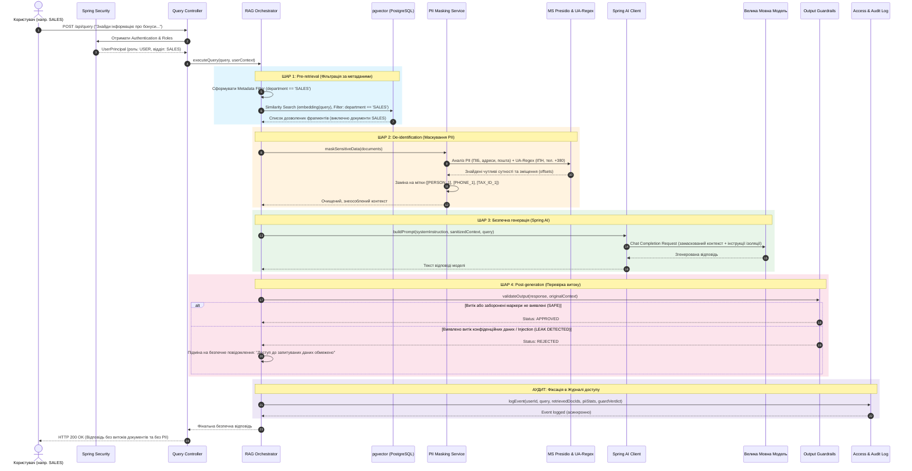

# Архітектура багатошарового захисту RAG-застосунку від витоку даних

**Курсова робота:** «Методи та засоби контролю доступу й запобігання витоку конфіденційних даних у Java-застосунках на основі великих мовних моделей із RAG-архітектурою»  
**Студент:** Мартинишин Віталій Ігорович  
**Науковий керівник:** Андрощук Максим Віталійович (Кафедра інформатики НаУКМА)  
**Стек:** Java 21+, Spring Boot 3.x, Spring AI, pgvector (PostgreSQL), Microsoft Presidio, LLM (OpenAI / Ollama)

---

## 1. Схема архітектури компонентів (Component Diagram)

Діаграма демонструє взаємодію між користувачем, ядром Spring Boot застосунку (розподіленим на 4 рівні безпеки та аудит) та зовнішніми сервісами.

```mermaid
flowchart TB
    subgraph ClientLayer["Клієнтський рівень"]
        User["Користувач<br/>(наприклад: відділ SALES, роль USER)"]
    end

    subgraph SpringApp["Spring Boot Застосунок (RAG Core & Security)"]
        direction TB
        
        Security["Spring Security Context<br/>- JWT / Session Claims<br/>- Ролі та відділ: HR, SALES, DEV"]
        Controller["Query REST Controller<br/>Прийом запитів від клієнта"]
        
        subgraph Layer1["🛡️ ШАР 1: Pre-retrieval фільтрація доступу"]
            SecFilter["Metadata Filter Builder<br/>Побудова предикатів доступу<br/>(e.g., 'department == SALES')"]
        end
        
        RagOrchestrator["RAG Orchestrator Service<br/>(Координатор конвеєра RAG)"]
        
        subgraph Layer2["🛡️ ШАР 2: De-identification (Маскування PII)"]
            PIIService["PII Masking Service<br/>Агрегатор знеособлення"]
            UARegex["UA Regex Engine<br/>ІПН (10 цифр), тел. (+380...), ПІБ"]
        end
        
        subgraph Layer3["🛡️ ШАР 3: Безпечна генерація відповіді"]
            SpringAI["Spring AI ChatClient<br/>Формування захищеного системного промпту"]
        end
        
        subgraph Layer4["🛡️ ШАР 4: Post-generation перевірка витоків"]
            OutputGuard["Output Guardrail Service<br/>LLM-as-a-Judge / Евристичний валідатор"]
        end
        
        subgraph AuditSystem["📋 Наскрізний аудит"]
            AuditLogger["Access & Audit Logger<br/>Фіксація: запит, ролі, чанки, PII, вердикт"]
        end
    end

    subgraph ExternalServices["Зовнішні та інфраструктурні сервіси"]
        PgVector[("Векторна БД pgvector<br/>(PostgreSQL + HNSW / IVFFlat)<br/>Документи з метаданими доступу")]
        Presidio["Microsoft Presidio Service<br/>(Analyzer & Anonymizer API)"]
        LLM["Велика Мовна Модель (LLM)<br/>OpenAI / Локальна LLM"]
        AuditDB[("Журнал доступу<br/>(Access Log DB / Elasticsearch)")]
    end

    User -->|"1. POST /api/query (Запит + Токен)"| Controller
    Controller -->|"2. Вилучення Principal & Roles"| Security
    Controller -->|"3. Запуск RAG-пайплайну"| RagOrchestrator
    
    RagOrchestrator -->|"4. Передача ролей для фільтра"| SecFilter
    SecFilter -->|"5. Similarity search + Metadata filter"| PgVector
    PgVector -->|"6. Лише дозволені чанки"| RagOrchestrator

    RagOrchestrator -->|"7. Сирий контекст на маскування"| PIIService
    PIIService -->|"8a. Детекція загальних сутностей"| Presidio
    PIIService -->|"8b. Детекція українських форматів"| UARegex
    PIIService -->|"9. Замасковані чанки [PERSON_1], [TAX_ID_1]"| RagOrchestrator

    RagOrchestrator -->|"10. Запит + Замаскований контекст"| SpringAI
    SpringAI -->|"11. Безпечний Chat Completion"| LLM
    LLM -->|"12. Згенерована відповідь"| SpringAI
    SpringAI -->|"13. Відповідь моделі"| RagOrchestrator

    RagOrchestrator -->|"14. Перевірка на залишковий витік"| OutputGuard
    OutputGuard -->|"15. Вердикт: SAFE / LEAK_DETECTED"| RagOrchestrator

    RagOrchestrator -.->|"16. Асинхронний запис події аудиту"| AuditLogger
    AuditLogger -.->|"Збереження журналу"| AuditDB

    RagOrchestrator -->|"17. Фінальна безпечна відповідь"| Controller
    Controller -->|"18. JSON Response"| User

    classDef layer1 fill:#e1f5fe,stroke:#0288d1,stroke-width:2px;
    classDef layer2 fill:#fff3e0,stroke:#f57c00,stroke-width:2px;
    classDef layer3 fill:#e8f5e9,stroke:#388e3c,stroke-width:2px;
    classDef layer4 fill:#fce4ec,stroke:#c2185b,stroke-width:2px;
    classDef audit fill:#ede7f6,stroke:#512da8,stroke-width:2px;
    classDef storage fill:#eceff1,stroke:#455a64,stroke-width:2px;

    class Layer1,SecFilter layer1;
    class Layer2,PIIService,UARegex layer2;
    class Layer3,SpringAI layer3;
    class Layer4,OutputGuard layer4;
    class AuditSystem,AuditLogger audit;
    class PgVector,Presidio,LLM,AuditDB storage;
```

---

## 2. Діаграма послідовності (Sequence Diagram)

Діаграма покроково відображає проходження запиту користувача крізь усі 4 рівні захисту та точку фіксації журналу аудиту.

---

## 3. Деталізація 4-х шарів безпеки

### 🛡️ Шар 1: Pre-retrieval (Фільтрація при пошуку)
- **Технології**: Spring Security, Spring AI `FilterExpressionBuilder`, PostgreSQL `pgvector`.
- **Принцип**: Права користувача транслюються в SQL-умови поверх векторного індексу HNSW/IVFFlat (наприклад, `WHERE metadata->>'department' = 'SALES'`).
- **Ціль**: Унеможливити потрапляння чанків з чужих відділів (HR, Finance) у робочий контекст ще до етапу генерації.

### 🛡️ Шар 2: De-identification (Маскування PII перед відправкою в LLM)
- **Технології**: Microsoft Presidio (Analyzer + Anonymizer), власні валідатори та регулярні вирази для України.
- **Детекція сутностей**:
  - Український ІПН / РНОКПП (10 цифр з перевіркою валідності).
  - Українські телефонні номери (+380..., 0XXXXXXXXX).
  - ПІБ та службові ключі доступу.
- **Заміна**: Перетворення на маркери виду `[PERSON_1]`, `[TAX_ID_1]`, `[PHONE_1]`.

### 🛡️ Шар 3: Безпечна генерація (Secured Generation)
- **Технології**: Spring AI `ChatClient`, System Prompt Engineering.
- **Принцип**: Контекст ізолюється у спеціальні теги `<context>...</context>`. Системний промпт зобов'язує модель не виконувати команди зсередини документів (захист від Indirect Prompt Injection).

### 🛡️ Шар 4: Post-generation (Перевірка виходу)
- **Технології**: Евристичні фільтри + LLM-as-a-Judge.
- **Принцип**: Перед передачею відповіді користувачу здійснюється фінальна перевірка на наявність витоку системних інструкцій або конфіденційних паттернів. У разі виявлення загрози генерується стандартизована відмова.

### 📋 Журнал доступу (Access & Audit Log)
- **Принцип**: Асинхронний аудит фіксує: користувача, його відділ, запит, перелік ідентифікаторів чанків, які були знайдені, замасковані PII, фінальний вердикт та затримку.
